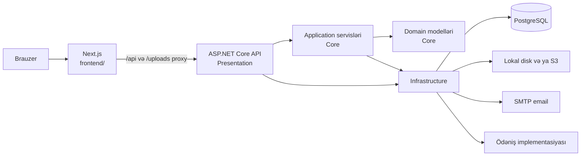

# Gardrop

Gardrop Azərbaycandakı geyim mağazalarını alıcılarla birləşdirən çoxsatıcılı marketplace layihəsidir. Alıcılar məhsulları axtarıb sifariş edə, mağazalar isə məhsul və sifarişlərini idarə edə bilirlər.

## Əsas imkanlar

- Məhsul kataloqu, kateqoriyalar, axtarış, filtrlər və mağaza səhifələri
- Email təsdiqi ilə qeydiyyat və giriş, Google giriş dəstəyi, JWT autentifikasiyası
- Səbət, favoritlər, ünvanlar, kuponlar, çatdırılma təklifi və sifarişlərin izlənməsi
- Məhsul variantları və stok, rəylər, ölçü tövsiyəsi
- Satıcı paneli: məhsullar, sifarişlər, rəylər və maliyyə məlumatları
- Admin paneli: kataloq moderasiyası, istifadəçilər, sifarişlər, kuponlar, mübahisələr və analitika

## Texnologiyalar

- **Vitrin və panellər:** Next.js 15, React 19, TypeScript
- **API:** ASP.NET Core / .NET 10
- **Məlumat bazası:** PostgreSQL və Entity Framework Core 10
- **Şəkillər:** lokal disk və ya S3 uyğun obyekt anbarı
- **Deploy üçün nəzərdə tutulan proxy:** nginx, systemd

## Repozitoriyanın quruluşu

| Yol | Təsviri |
| --- | --- |
| `frontend/` | Next.js tətbiqi, vitrin, admin və satıcı səhifələri |
| `backend-csharp/Core/` | Domain modelləri, DTO-lar, tətbiq servisləri və interfeyslər |
| `backend-csharp/Infrastructure/` | PostgreSQL, EF Core, migration-lar və xarici servis implementasiyaları |
| `backend-csharp/Presentation/` | ASP.NET Core API, controller-lər və tətbiqin giriş nöqtəsi |
| `backend-csharp/Tests/` | xUnit test layihəsi |
| `deploy/` | nginx və systemd nümunələri, mövcud deploy qeydləri |
| `Gardrop_Huquqi_Senedler_Yekun.pdf` | Repozitoriyadakı hüquqi sənəd |

Daha ətraflı: [arxitektura](docs/ARCHITECTURE.md), [API marşrutları](docs/API.md), [lokal işə salma və konfiqurasiya](docs/DEVELOPMENT.md).

## Lokal işə salma

Tələblər: .NET SDK 10, PostgreSQL 14 və npm. API və frontend-i ayrı terminallarda başladın.

### 1. Məlumat bazası və API

PostgreSQL-də `gardrop` bazası yaradın. Sonra:

```bash
cd backend-csharp/Presentation
dotnet user-secrets set "ConnectionStrings:Default" "Host=localhost;Port=5432;Database=gardrop;Username=postgres;Password=<şifrəniz>"
dotnet user-secrets set "Jwt:Secret" "<ən azı 32 simvolluq təsadüfi açar>"
dotnet ef database update -p ../Infrastructure -s .
dotnet run
```

API standart lokal konfiqurasiyada `http://localhost:3001` ünvanında işləyir. İlk işə düşmə zamanı verilənlər bazası seed edilir. Migration əmrləri üçün `dotnet-ef` aləti tələb oluna bilər:

```bash
dotnet tool install --global dotnet-ef
```

### 2. Frontend

```bash
cd frontend
npm ci
npm run dev
```

Vitrin `http://localhost:5173` ünvanında açılır. Admin və satıcı səhifələri müvafiq olaraq `/admin` və `/magaza` yollarındadır. Next.js server tərəfdən API-yə qoşulmaq üçün `API_ORIGIN` dəyişənini qəbul edir; standart dəyər `http://localhost:3001`-dir.

### Testlər və statik yoxlama

```bash
dotnet test backend-csharp/Tests/Gardrop.Tests.csproj
```

Frontend skriptləri:

```bash
cd frontend
npm run typecheck
npm run lint
npm run build
```

## Sənədlər və deploy vəziyyəti

Mövcud `deploy/DEPLOY.md`, `deploy/gardrop-next.service` və `start.bat` fayllarında `frontend-next/` qovluğuna istinadlar var. Hazırkı repoda tətbiq `frontend/` qovluğundadır. Deploy nümunələrində həmçinin portlar və `API_BASE_URL` dəyişəni mənbə kodundakı konfiqurasiyadan fərqlənir. Buna görə deploy təlimatları hazırkı checkout üçün yoxlanmış işə salma addımları hesab edilməməlidir; detallar və həll edilməli məqamlar [inkişaf sənədində](docs/DEVELOPMENT.md) qeyd olunub.

## Qeyd

Sənədlər repodakı mənbə kodu və konfiqurasiya fayllarına əsasən hazırlanıb. Payment provider seçiminin real işləkliyi və production deploy konfiqurasiyası ayrıca yoxlanmalıdır.


# Gardrop arxitekturası

Bu sənəd repozitoriyanın hazırkı quruluşunu təsvir edir. Backend-də Domain və Application eyni `Core` layihəsində saxlanılır.

## Ümumi görünüş



Frontend-in Next.js konfiqurasiyası `/api/*` və `/uploads/*` sorğularını `API_ORIGIN` ünvanına yönləndirir. SSR/ISR vitrini üçün kataloq, mağaza, kateqoriya və CMS məlumatlarını backend-dən oxuyur. Əsas vitrinin ISR yenilənmə intervalı 60 saniyədir.

## Backend qatları

| Layihə | Məsuliyyət |
| --- | --- |
| `Core/Domain` | İstifadəçi, məhsul, mağaza, sifariş, kupon, rəy, mübahisə kimi modellər və status enum-ları |
| `Core/Application` | Use-case servisləri, DTO-lar, interfeyslər, validasiya və biznes qaydaları |
| `Infrastructure` | `AppDbContext`, Npgsql/EF Core, migration-lar, email/JWT/storage/şəkil və digər servis implementasiyaları |
| `Presentation` | HTTP controller-lər, autentifikasiya, CORS, rate limit, OpenAPI və middleware |
| `Tests` | xUnit testləri; EF Core InMemory və API smoke test infrastrukturu |

Application servisləri persistence interfeysi `IAppDbContext`-ə bağlanır. Presentation qatı Infrastructure üçün dependency injection genişləndirmələrini çağırır.

## Frontend

- `frontend/app` Next.js App Router səhifələrini saxlayır.
- `frontend/components/store` alıcı vitrininin UI-sini və səhifə komponentlərini saxlayır.
- `frontend/components/admin` admin panelini saxlayır.
- `frontend/components/magaza` satıcı panelini saxlayır.
- Əsas vitrinin UI-si client komponent kimi işləyir; Next.js səhifələri ilkin məlumatı server tərəfdən hazırlaya bilir.
- Saytın əsas dili Azərbaycan dilidir; interfeys lüğətlərində rus və ingilis variantları da mövcuddur.

## Məlumat və fayllar

PostgreSQL verilənləri EF Core migration-ları ilə idarə olunur. `DbSeeder` tətbiq başlayanda ilkin məlumatları əlavə edir. Model konfiqurasiyasında yumşaq silmə filtrləri, audit vaxtları, məhsul ölçü/rəng variantları və axtarış üçün indekslər mövcuddur.

Şəkil anbarı `Storage:Provider` ilə seçilir: lokal disk və ya S3 uyğun servis. API yüklənmiş faylları `/uploads` yolu ilə təqdim edir. Upload zamanı şəkillər optimallaşdırılır və WebP/thumbnail emalı tətbiq olunur.

## Əsas biznes axınları

### Giriş

Qeydiyyat və giriş email kodu ilə təsdiq addımlarından keçir. Uğurlu autentifikasiyadan sonra API JWT qaytarır. Google giriş validatoru da mövcuddur. Development mühitində email kodu yaddaşda tutula bilər; bu mexanizm production üçün nəzərdə tutulmayıb.

### Kataloq və ölçü

Məhsul kataloqu axtarış, kateqoriya, qiymət, mağaza və endirim filtrlərini dəstəkləyir. Məhsul variantları ölçü/rəng, SKU və stokla saxlanır. Ölçü tövsiyəsi geyim, ayaqqabı və mağazanın xüsusi ölçü cədvəli strategiyalarını seçir.

### Sifariş və çatdırılma

Sifariş məbləği backend-də hesablanır. Checkout kuponun yoxlanmasını və səbətə əsaslanan çatdırılma təklifini təqdim edir. Ödəniş və sifariş statusları API-də idarə olunur. Ekspress sifarişlər üçün 30 dəqiqəlik avtomatik ləğv fon xidməti var.

### Satıcı və admin

Satıcı servisləri öz mağazasının məhsul, sifariş, rəy və maliyyə məlumatlarına çıxışı idarə edir. Admin policy-si olan endpoint-lər kataloq moderasiyası, istifadəçi/sifariş əməliyyatları, kuponlar, mübahisələr, ödəniş və analitika idarəsini təmin edir.

### Fon xidmətləri

Infrastructure qatında müddəti bitmiş OTP-lərin təmizlənməsi, ekspress sifarişlərin avtomatik ləğvi, reytinq yenilənməsi və vaxtında cavablandırılmayan problemlərin eskalasiyası üçün hosted service-lər qeydiyyatdan keçirilib.

## Ödəniş inteqrasiyasına dair qeyd

`StripePaymentService` mənbə kodunda var, amma dependency injection konfiqurasiyasında hazırda provider seçimi həmişə `CodPaymentService`-ə düşür. Buna görə Stripe-ın işlək olması yalnız nümunə konfiqurasiya açarlarının mövcudluğundan nəticə çıxarıla bilməz. Onlayn ödəniş üçün DI seçimi və webhook axını ayrıca yoxlanmalıdır.

## Təhlükəsizlik sərhədləri

- Production-da verilənlər bazası bağlantısı və 32 simvoldan uzun JWT açarı tələb olunur.
- Production-da CORS origin-ləri boş ola bilməz.
- Auth, axtarış və kupon endpoint-lərinə ayrıca IP əsaslı limitlər tətbiq olunur; bütün sorğular üçün qlobal limit də var.
- Admin endpoint-ləri `Admin` authorization policy-si ilə qorunur.
- İstifadəçi mətnləri sanitizasiya olunur; soft-delete üçün qlobal query filter istifadə olunur.
- Sirlər repoya əlavə edilməməli, development-də User Secrets, production-da environment variable kimi ötürülməlidir.


# API arayışı

API ASP.NET Core tətbiqində yerləşir və marşrutların kökü `/api`-dir. Əsas marşrutlar URL-də versiya seqmenti daşımır. Versiya göstərilməzsə API v1.0 qəbul edir; istəyə görə `?api-version=1.0` və ya `X-Api-Version: 1.0` istifadə oluna bilər.

Development mühitində OpenAPI sənədi `/openapi/v1.json`, Scalar UI isə `/scalar` ünvanında açılır. Bu iki endpoint production-da aktiv edilmir.

## Cavab formatı və autentifikasiya

- JSON sahələri camelCase, enum dəyərləri sətir kimi serializasiya olunur.
- Model validasiyası və tətbiq xətaları əsasən `{ "error": "..." }` formatında qaytarılır.
- Token tələb edən sorğularda `Authorization: Bearer <JWT>` başlığını göndərin.
- Ümumi limit: IP başına dəqiqədə 120 sorğu. Auth: 10/dəq; məhsul kataloqu: 40/dəq; kupon yoxlaması: 8/dəq. Limit keçildikdə `429` qaytarılır.

## Alıcı üçün açıq marşrutlar

| Metod | Marşrut | Təsviri |
| --- | --- | --- |
| GET | `/api/products` | Kataloq; `search`, `category`, `subcategory`, `sort`, `minPrice`, `maxPrice`, `discount`, `store`, `page`, `pageSize` sorğu parametrləri |
| GET | `/api/products/{id}` | Məhsulu ID ilə alır |
| GET | `/api/products/slug/{slug}` | Məhsulu SEO slug ilə alır |
| GET | `/api/categories` | Kateqoriyalar |
| GET | `/api/stores` | Mağazaların siyahısı |
| GET | `/api/stores/{id}` | Mağazanı ID ilə alır |
| GET | `/api/stores/by-url/{slug}` | Mağazanı slug ilə alır |
| GET | `/api/content` | Sayt məzmunu |
| GET | `/api/content/{key}` | Məzmun elementini açarla alır |
| GET | `/api/reviews/{productId}` | Məhsul rəyləri |
| GET | `/api/payments/config` | Frontend üçün ödəniş konfiqurasiyası |
| GET | `/api/health` | API sağlamlıq xülasəsi |
| GET | `/health/live` | Liveness yoxlaması |
| GET | `/health/ready` | Verilənlər bazası readiness yoxlaması |

## Autentifikasiya və profil

| Metod | Marşrut | Giriş |
| --- | --- | --- |
| POST | `/api/auth/register` | Açıq |
| POST | `/api/auth/verify-email` | Açıq |
| POST | `/api/auth/resend-verification` | Açıq |
| POST | `/api/auth/login` | Açıq |
| POST | `/api/auth/login-verify` | Açıq |
| POST | `/api/auth/resend-login` | Açıq |
| POST | `/api/auth/forgot` | Açıq |
| POST | `/api/auth/reset` | Açıq |
| POST | `/api/auth/google` | Açıq |
| GET | `/api/auth/me` | JWT |
| GET/POST/PUT/DELETE | `/api/addresses` və `/api/addresses/{id}` | JWT |
| PUT | `/api/profile` | JWT |
| PUT | `/api/profile/measurements` | JWT |
| POST | `/api/profile/password` | JWT |
| GET/POST/PUT/DELETE | `/api/cart`, `/api/cart/{productId}` | JWT |
| GET | `/api/favorites`, `/api/favorites/ids` | JWT |
| POST/DELETE | `/api/favorites/{productId}` | JWT |
| GET | `/api/notifications` | JWT |
| POST | `/api/notifications/read`, `/api/notifications/{id}/read` | JWT |
| GET/POST | `/api/size-recommendation/{productId}`, `/api/size-recommendation` | JWT |

## Checkout və sifarişlər

| Metod | Marşrut | Giriş |
| --- | --- | --- |
| POST | `/api/coupons/validate` | Açıq; coupon rate limit |
| POST | `/api/delivery/quote` | JWT |
| GET/POST | `/api/orders` | JWT |
| GET | `/api/orders/{id}` | JWT |
| POST | `/api/orders/{id}/cancel` | JWT |
| POST | `/api/orders/{id}/problem` | JWT |
| POST | `/api/orders/{id}/dispute` | JWT; köhnə şikayət axını |
| GET | `/api/problems/my` | JWT |
| GET | `/api/problems/{id}` | JWT |
| POST | `/api/problems/{id}/cancel` | JWT |
| POST | `/api/payments/webhook` | Açıq; imzanın yoxlanması ödəniş provayderindən asılıdır |

## Satıcı paneli

Bu marşrutlar JWT tələb edir; servis qatında mağaza sahibliyi də yoxlanılır.

- `GET /api/store/me`; `PUT /api/store/me/{id}`
- `GET /api/store/{id}/settings`, `/dashboard`, `/analytics`, `/finance`
- Məhsullar: `GET/POST /api/store/{id}/products`; `PUT/DELETE /api/store/{id}/products/{pid}`
- Sifarişlər: `GET /api/store/{id}/orders`; `PUT /api/store/{id}/orders/{oid}/status`; `POST /api/store/{id}/orders/{oid}/courier`
- Problemlər: `GET /api/store/{id}/problems`; `POST /api/store/{id}/problems/{pid}/respond`; `POST /api/store/{id}/problems/{pid}/received`
- Rəylər: `GET /api/store/{id}/reviews`; `PUT /api/store/{id}/reviews/{rid}/reply`

## Admin paneli

Admin marşrutları `Admin` policy-si ilə qorunur.

- Problemlər, mübahisələr və audit: `/api/admin/problems`, `/api/admin/disputes`, `/api/admin/activity`
- Analitika: `/api/admin/stats`, `/api/admin/analytics`, mağaza detalları
- İstifadəçilər: `/api/admin/users` və `/api/admin/users/{id}` əməliyyatları
- Məhsullar: `/api/admin/products`, approval, bulk əməliyyatı və silmə
- Mağazalar: `/api/admin/stores` və mağaza detalları
- Kuponlar: `/api/admin/coupons`
- Kateqoriyalar: `/api/admin/categories`
- Sifarişlər: `/api/admin/orders`
- Rəylər: `/api/admin/reviews`
- Komissiyalar və ödəniş çıxarışları: `/api/admin/stores/{storeId}/commissions`, `/api/admin/stores/{storeId}/payouts`
- Mətn məzmunu: `PUT /api/admin/content/{key}`
- Şəkil backfill: `POST /api/admin/maintenance/images/backfill`

## Səhvləri araşdırma

1. `401` token çatışmadığını və ya etibarsız olduğunu, `403` isə istifadəçinin policy/ownership tələbinə cavab vermədiyini göstərə bilər.
2. `429` IP üzrə limit keçildiyini göstərir.
3. `/health/ready` uğursuzdursa PostgreSQL bağlantısını və migration vəziyyətini yoxlayın.
4. Development-də `/scalar` və `/openapi/v1.json` endpoint-lərindən sorğu sxemlərini və cavabları yoxlayın.

Bu arayış marşrut inventarıdır; bütün DTO sahələrinin və mümkün status kodlarının tam sxemini əvəz etmir.
