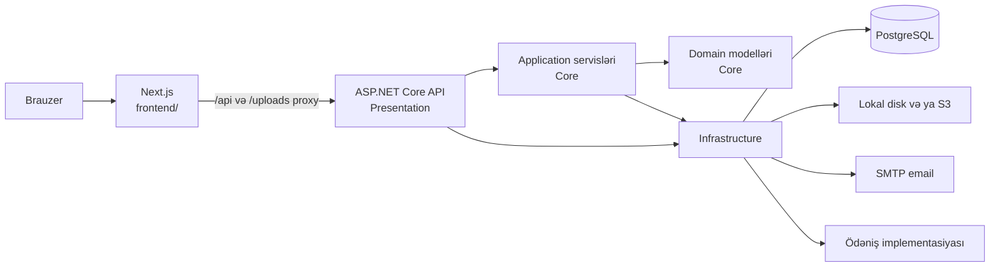

# Gardrop arxitekturası

Bu sənəd repozitoriyanın hazırkı quruluşunu təsvir edir. Backend-də Domain və Application eyni `Core` layihəsində saxlanılır.

## Ümumi görünüş

Frontend-in Next.js konfiqurasiyası `/api/*` və `/uploads/*` sorğularını `API_ORIGIN` ünvanına yönləndirir. SSR/ISR vitrini üçün kataloq, mağaza, kateqoriya və CMS məlumatlarını backend-dən oxuyur. Əsas vitrinin ISR yenilənmə intervalı 60 saniyədir.

## Backend qatları

| Layihə | Məsuliyyət |
| --- | --- |
| `Core/Domain` | İstifadəçi, məhsul, mağaza, sifariş, kupon, rəy, mübahisə kimi modellər və status enum-ları |
| `Core/Application` | Use-case servisləri, DTO-lar, interfeyslər, validasiya və biznes qaydaları |
| `Infrastructure` | `AppDbContext`, Npgsql/EF Core, migration-lar, email/JWT/storage/şəkil və digər servis implementasiyaları |
| `Presentation` | HTTP controller-lər, autentifikasiya, CORS, rate limit, OpenAPI və middleware |
| `Tests` | xUnit testləri; EF Core InMemory və API smoke test infrastrukturu |

Application servisləri persistence interfeysi `IAppDbContext`-ə bağlanır. Presentation qatı Infrastructure üçün dependency injection genişləndirmələrini çağırır.

## Frontend

- `frontend/app` Next.js App Router səhifələrini saxlayır.
- `frontend/components/store` alıcı vitrininin UI-sini və səhifə komponentlərini saxlayır.
- `frontend/components/admin` admin panelini saxlayır.
- `frontend/components/magaza` satıcı panelini saxlayır.
- Əsas vitrinin UI-si client komponent kimi işləyir; Next.js səhifələri ilkin məlumatı server tərəfdən hazırlaya bilir.
- Saytın əsas dili Azərbaycan dilidir; interfeys lüğətlərində rus və ingilis variantları da mövcuddur.

## Məlumat və fayllar

PostgreSQL verilənləri EF Core migration-ları ilə idarə olunur. `DbSeeder` tətbiq başlayanda ilkin məlumatları əlavə edir. Model konfiqurasiyasında yumşaq silmə filtrləri, audit vaxtları, məhsul ölçü/rəng variantları və axtarış üçün indekslər mövcuddur.

Şəkil anbarı `Storage:Provider` ilə seçilir: lokal disk və ya S3 uyğun servis. API yüklənmiş faylları `/uploads` yolu ilə təqdim edir. Upload zamanı şəkillər optimallaşdırılır və WebP/thumbnail emalı tətbiq olunur.

## Əsas biznes axınları

### Giriş

Qeydiyyat və giriş email kodu ilə təsdiq addımlarından keçir. Uğurlu autentifikasiyadan sonra API JWT qaytarır. Google giriş validatoru da mövcuddur. Development mühitində email kodu yaddaşda tutula bilər; bu mexanizm production üçün nəzərdə tutulmayıb.

### Kataloq və ölçü

Məhsul kataloqu axtarış, kateqoriya, qiymət, mağaza və endirim filtrlərini dəstəkləyir. Məhsul variantları ölçü/rəng, SKU və stokla saxlanır. Ölçü tövsiyəsi geyim, ayaqqabı və mağazanın xüsusi ölçü cədvəli strategiyalarını seçir.

### Sifariş və çatdırılma

Sifariş məbləği backend-də hesablanır. Checkout kuponun yoxlanmasını və səbətə əsaslanan çatdırılma təklifini təqdim edir. Ödəniş və sifariş statusları API-də idarə olunur. Ekspress sifarişlər üçün 30 dəqiqəlik avtomatik ləğv fon xidməti var.

### Satıcı və admin

Satıcı servisləri öz mağazasının məhsul, sifariş, rəy və maliyyə məlumatlarına çıxışı idarə edir. Admin policy-si olan endpoint-lər kataloq moderasiyası, istifadəçi/sifariş əməliyyatları, kuponlar, mübahisələr, ödəniş və analitika idarəsini təmin edir.

### Fon xidmətləri

Infrastructure qatında müddəti bitmiş OTP-lərin təmizlənməsi, ekspress sifarişlərin avtomatik ləğvi, reytinq yenilənməsi və vaxtında cavablandırılmayan problemlərin eskalasiyası üçün hosted service-lər qeydiyyatdan keçirilib.

## Ödəniş inteqrasiyasına dair qeyd

`StripePaymentService` mənbə kodunda var, amma dependency injection konfiqurasiyasında hazırda provider seçimi həmişə `CodPaymentService`-ə düşür. Buna görə Stripe-ın işlək olması yalnız nümunə konfiqurasiya açarlarının mövcudluğundan nəticə çıxarıla bilməz. Onlayn ödəniş üçün DI seçimi və webhook axını ayrıca yoxlanmalıdır.

## Təhlükəsizlik sərhədləri

- Production-da verilənlər bazası bağlantısı və 32 simvoldan uzun JWT açarı tələb olunur.
- Production-da CORS origin-ləri boş ola bilməz.
- Auth, axtarış və kupon endpoint-lərinə ayrıca IP əsaslı limitlər tətbiq olunur; bütün sorğular üçün qlobal limit də var.
- Admin endpoint-ləri `Admin` authorization policy-si ilə qorunur.
- İstifadəçi mətnləri sanitizasiya olunur; soft-delete üçün qlobal query filter istifadə olunur.
- Sirlər repoya əlavə edilməməli, development-də User Secrets, production-da environment variable kimi ötürülməlidir.
